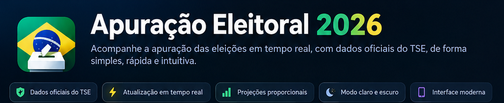
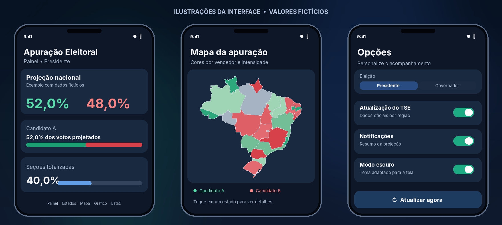
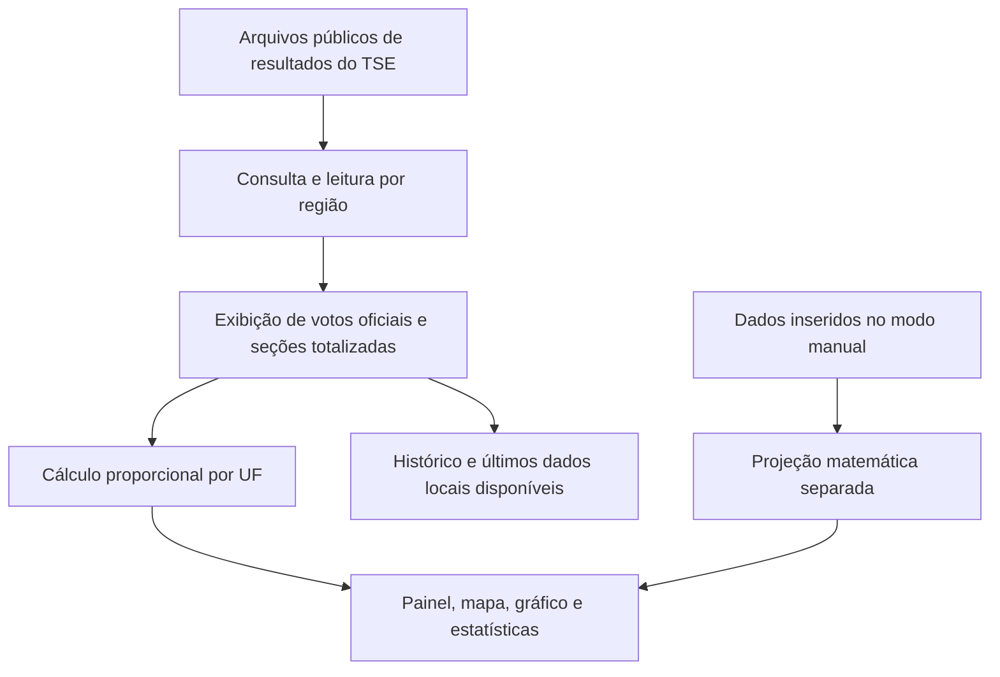
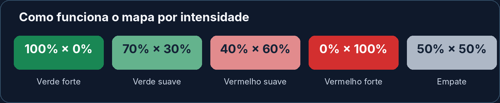

<p align="center">
  
</p>

<p align="center">
  
  
  
  
  
</p>

<p align="center">
  <strong>Resultados oficiais, projeções proporcionais e uma visão interativa da apuração eleitoral brasileira.</strong><br>
  Aplicativo Android desenvolvido em Kotlin e Jetpack Compose para acompanhar a eleição de 2026 de maneira visual, organizada e intuitiva.
</p>

<p align="center">
  <a href="#-funcionalidades">Funcionalidades</a> ·
  <a href="#-como-funciona">Como funciona</a> ·
  <a href="#-instalação">Instalação</a> ·
  <a href="#-desenvolvimento">Desenvolvimento</a> ·
  <a href="#%EF%B8%8F-aviso-importante">Aviso importante</a>
</p>

---

## 📱 Conheça o aplicativo

O **Apuração Eleitoral 2026** permite acompanhar os números divulgados pelo **Tribunal Superior Eleitoral (TSE)** e explorar estimativas matemáticas do resultado final, levando em conta o andamento da apuração em cada unidade da Federação.

O projeto reúne dados, gráficos, mapa interativo, histórico e notificações em uma interface com **modo claro e escuro**, **navegação flutuante em formato de pílula** e menus com efeitos de transparência e desfoque.

<p align="center">
  
</p>

> **Nota sobre as imagens:** estas são **ilustrações da interface**, não capturas reais. Os números e a distribuição de cores apresentados são **fictícios**, apenas para demonstrar o visual do aplicativo.

## ✨ Funcionalidades

| Recurso | O que faz |
| --- | --- |
| 🗳️ **Resultados oficiais do TSE** | Consulta os arquivos públicos de totalização da eleição presidencial, incluindo Brasil, 27 UFs e exterior, quando disponíveis. |
| 🔄 **Atualização automática** | Consulta periodicamente as informações do TSE, com intervalo normal de aproximadamente **60 segundos** e tratamento de indisponibilidade. |
| 📊 **Projeções proporcionais** | Estima votos finais para cada candidato a partir dos votos contabilizados e do percentual de seções totalizadas por região. |
| 🗺️ **Mapa interativo do Brasil** | Mostra os estados com a cor do candidato à frente e intensidade de acordo com a vantagem; permite selecionar UFs. |
| 📍 **Apuração por estado** | Exibe votos, progresso das seções, comparecimento, abstenções, brancos, nulos e estimativas por região. |
| 📈 **Evolução das projeções** | Apresenta em gráfico o histórico dos percentuais projetados ao longo das atualizações. |
| 📋 **Estatísticas** | Reúne totais oficiais, indicadores de participação e números projetados. |
| 🧮 **Modo manual** | Permite informar dados e testar cenários sem sobrescrever os registros oficiais armazenados. |
| 🏛️ **Segundo turno para governador** | Acompanha as disputas estaduais contempladas pelo aplicativo: **AC, AM, DF, ES, RN e TO**. |
| 🔔 **Notificação persistente** | Mantém um resumo da projeção, com opção de encerrar pela própria notificação; sujeito às permissões e restrições do Android. |
| 🌙 **Modo claro e escuro** | Adapta painéis, textos, mapa, menus, gráficos e indicadores do sistema. |
| 🫧 **Interface em vidro** | Barra inferior flutuante com transparência, blur e transições animadas entre abas. |

### Navegação em cinco abas

| Aba | Conteúdo |
| :---: | --- |
| **Painel** | Resumo da apuração e principais projeções. |
| **Estados** | Consulta detalhada por UF e exterior, com seletor de regiões. |
| **Mapa** | Visão geográfica interativa do desempenho dos candidatos. |
| **Gráfico** | Evolução temporal dos percentuais projetados. |
| **Estatísticas** | Dados adicionais sobre totalização e participação eleitoral. |

O menu de **três pontos**, dentro da barra inferior, concentra a escolha da eleição, o modo Manual/TSE, notificações, modo escuro e sincronização.

## 🧭 Como funciona



### Dados oficiais × projeção matemática

O aplicativo diferencia dois tipos de informação:

- **Votos oficiais:** quantidades divulgadas nos arquivos de resultados do TSE.
- **Projeções não oficiais:** estimativas calculadas pelo aplicativo para tentar representar o restante da apuração.

A base do cálculo por região é:

```text
Votos projetados = votos já contabilizados ÷ (seções totalizadas % / 100)
```

**Exemplo hipotético:** se uma UF tem 20% das seções totalizadas e um candidato recebeu 120.000 votos até aquele momento, a projeção proporcional para ele será de **600.000 votos** nessa UF. O procedimento é aplicado a cada região com dados suficientes; a soma das projeções disponíveis compõe a estimativa agregada.

> ⚠️ **Atenção:** esta é uma extrapolação matemática, **não uma pesquisa eleitoral, previsão estatística ou resultado oficial**. Se as primeiras seções apuradas forem diferentes das restantes, a estimativa poderá variar bastante. Percentual de **seções** totalizadas também não corresponde necessariamente ao percentual de **votos** já apurados. Regiões ainda sem dados podem tornar a projeção nacional parcial.

### 🎨 Cores do mapa

O mapa utiliza **a cor de quem está à frente**, em vez de misturar verde e vermelho. Uma vitória mais ampla produz uma tonalidade mais forte, enquanto uma vantagem menor aparece com um tom mais suave.

<p align="center">
  
</p>

No modo presidencial, **verde** corresponde a Flávio Bolsonaro e **vermelho** a Lula. Um **empate exato** recebe cor neutra; regiões **sem dados** são diferenciadas visualmente. As disputas de governador utilizam outra paleta para distinguir seus candidatos.

### 🏛️ Governadores

O aplicativo inclui uma visualização própria para os segundos turnos estaduais previstos no código (**AC, AM, DF, ES, RN e TO**). Os candidatos e números de cada disputa são tratados separadamente. **Votos de governador não são somados aos votos presidenciais.**

### ✍️ Modo manual

Ideal para explorar cenários: informe a porcentagem de seções totalizadas e os votos de cada candidato, além de outros indicadores disponíveis. Os registros manuais ficam **separados** dos dados oficiais e são salvos localmente no aparelho.

## 📥 Instalação

### Pelo GitHub Actions

1. Abra a página de [**Actions**](https://github.com/HiagoDalmolin7/Apuracao-Eleitoral-2026/actions) deste repositório.
2. Entre no workflow **Gerar APK Android** e escolha uma execução bem-sucedida.
3. Na seção **Artifacts**, baixe o pacote contendo o APK.
4. Extraia o arquivo `.zip`, transfira o `.apk` para o celular e instale-o.
5. Se necessário, autorize temporariamente a instalação de aplicativos por essa origem nas configurações do Android.

**Compatibilidade definida no projeto:** Android **8.0 (API 26)** ou superior. Recursos gráficos e comportamentos de notificação podem variar conforme o aparelho e a versão do sistema.

> **Sobre atualizações:** o workflow atual gera um **APK de depuração (`assembleDebug`)**. A assinatura de depuração pode mudar entre compilações e impedir a instalação de uma versão por cima de outra. O ideal para distribuição contínua é configurar uma chave de assinatura permanente para builds de release. Desinstalar o aplicativo pode apagar os dados locais.

## 🛠️ Desenvolvimento

**Tecnologias utilizadas** (conforme os arquivos de configuração do projeto):

| Tecnologia | Configuração |
| --- | --- |
| Linguagem | Kotlin **2.4.21** |
| Interface | Jetpack Compose + Material 3 |
| Efeitos de vidro e blur | Haze **2.0.1** |
| Android Gradle Plugin | **9.4.1** |
| Gradle | **9.8.2** |
| JDK | **17** |
| SDK mínimo | **26** — Android 8.0 |
| SDK de compilação | **37.2** |
| SDK de destino | **37** |
| Armazenamento local | `SharedPreferences` |
| Integração de dados | Arquivos públicos do TSE via HTTPS |

### Executar ou compilar localmente

```bash
git clone https://github.com/HiagoDalmolin7/Apuracao-Eleitoral-2026.git
cd Apuracao-Eleitoral-2026
./gradlew assembleDebug
```

No Windows, utilize `gradlew.bat assembleDebug`. O ambiente deverá ter **JDK 17** e os componentes Android SDK exigidos pela configuração Gradle.

### Atualizações em segundo plano

O aplicativo dispõe de uma notificação baseada em serviço em primeiro plano. A frequência efetiva de atualização em segundo plano depende das regras de economia de energia e dos limites de serviços do Android, especialmente nas versões recentes do sistema.

## 🗂️ Armazenamento e transparência

O aplicativo mantém preferências, valores inseridos no modo manual, últimos arquivos válidos e histórico de projeções **localmente no dispositivo**, usando `SharedPreferences`. A consulta dos resultados é feita às fontes públicas do TSE. Não é necessário criar conta para utilizar as funcionalidades descritas.

Quando a fonte oficial ainda não disponibilizou resultados ou uma consulta falha, o aplicativo pode indicar indisponibilidade e conservar o último registro armazenado, em vez de tratar a ausência de dados como zero votos oficiais.

## 🤝 Contribuições e melhorias

Sugestões, relatórios de problemas e propostas de melhorias são bem-vindos! Você pode abrir uma [**Issue**](https://github.com/HiagoDalmolin7/Apuracao-Eleitoral-2026/issues) ou enviar um **Pull Request**.

Ideias para evolução do projeto incluem testes automatizados dos arquivos do TSE, validações adicionais de consistência, otimização de bateria e preparação de builds de release assinadas.

## ⚠️ Aviso importante

**Este é um projeto independente, sem vínculo institucional com o Tribunal Superior Eleitoral (TSE) ou com qualquer campanha ou partido político.**

Os resultados **oficiais** são os números publicados pelo TSE. As **projeções** exibidas pelo aplicativo são cálculos independentes, aproximados e **não oficiais**. Para conferir os resultados publicados pela Justiça Eleitoral, utilize a fonte primária:

🔗 **[Resultados oficiais do TSE](https://resultados.tse.jus.br/)**

---

<p align="center">
  Feito para acompanhar a apuração de forma mais clara, visual e acessível.<br>
  ⭐ <strong>Se o projeto for útil, deixe uma estrela no repositório!</strong>
</p>
